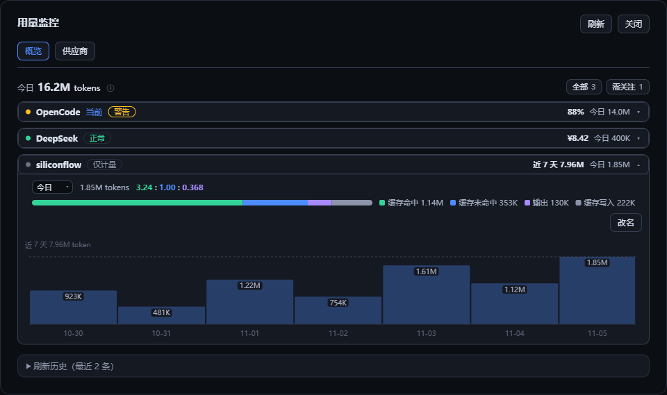
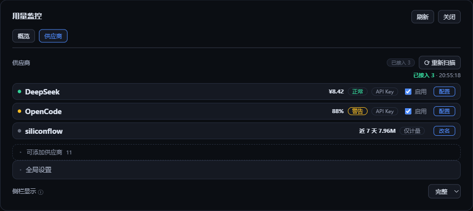

# dsh-token-quota

[](https://www.npmjs.com/package/@ds-hu/dsh-token-quota)
[](https://github.com/ds-hu/dsh-token-quota/actions/workflows/verify.yml)
[](LICENSE)
[](#install)

A usage monitor for DeepSeek Harness: periodic limits, account balances, reported spend and today's token count for
the supplier behind the current session — plus token statistics for any supplier the plugin does not know. Works in the
Windows desktop app and in the Web UI.

English · [中文](README.md)



Current version: **v2.7.0**. Requires **DSH ≥ 0.1.7-rc.2**; real desktop and Web verification runs on **DSH 0.2.0-rc.2**.

The Plugins panel shows it as **Usage monitor** (Chinese **用量监控**): the icon is `icon.svg` in the package root, and the
title and one-line description come from `meta` in `locale/zh.json` and `locale/en.json`.

[npm](https://www.npmjs.com/package/@ds-hu/dsh-token-quota) · [Issues](https://github.com/ds-hu/dsh-token-quota/issues)

## What's new in v2.7.0

- **No more Chinese leaking into the English UI.** Limit names (`余额 · CNY`, `模型 · …`, `月额度 · …`), window
  short labels and supplier names are now rendered from the client dictionary, so the English UI reads
  `Balance · CNY`, `Monthly quota · …` and `Moonshot (China)`. The Chinese display is unchanged character for
  character, and the supplier list is sorted by the rendered name.
- **Each breakdown figure has its own column.** Input, output, requests, credited, gifted, subscription and
  weekly bonus no longer ride in one `输入 1.2K · 输出 800 · 请求 12` string; the period column comes from a data
  field, and a missing value renders as "—" instead of a fabricated 0.
- **Explanations are collapsed by default.** Notes such as "billing may lag" or "does not cover every product"
  sit behind a single ⓘ in the details, so the default view carries data only.
- **The built-in holiday table now covers 2027 (29 days).** New Year 1/1–1/3, Spring Festival 2/5–2/13,
  Qingming 4/3–4/5, Labour Day 5/1–5/5, Dragon Boat 6/9, Mid-Autumn 9/15, National Day 10/1–10/7. Without them,
  18 weekday holidays would have been billed at the peak rate (126 peak hours) and the settings page kept
  flagging the gap. If you pasted a 2027 override earlier, clear it in Global settings at the bottom of the
  Suppliers page.

## What's new in v2.6.0

- **Token statistics for any supplier.** An LLM route that is not one of the built-in suppliers becomes a
  **"usage only"** row after its first real call: today and the last N days of tokens, the five-part breakdown and the
  normalised ratio — no quota query, no percentage, no new outbound request. Those tokens used to be dropped entirely.
- **Today's total is now the sum of the rows you can see.** Any row with today's usage is listed and counted, so the
  number can be checked by adding the rows up. The "current" mark now only says which supplier the widget is showing,
  not which row is counted.
- **DeepSeek desktop sign-in and API key are one row.** Tokens from the desktop login are counted as well; only the
  balance query still needs an API key.
- When a route is later adopted by a built-in supplier its history moves with it instead of restarting at zero, and a
  replacement sample that arrives mid-adoption is no longer counted twice.
- "Last N days" reads N from the usage retention setting instead of always saying 7.

## What's new in v2.5.0

- The "Today" label in an expanded row became a range picker (today / last 7 days); the token count, the ratio and the
  five-part bar all follow that range, while the chart stays on 7 days.
- Each window (5h / week / month) is estimated in tokens, switching between "left" and "plan total", with the sampling
  interval, the numerator and denominator, and the ±1pp band on hover.
- Estimates are derived from the slope (local tokens ÷ Δpp) rather than from cumulative used %, which halved the total
  whenever the window was longer than the local history.
- Bar labels are no longer struck through by the quota line: each sits on a card-coloured plate and the line passes behind
  it.

Earlier releases are recorded in [CHANGELOG](CHANGELOG.md).

## Install

The plugin is published on npm as **`@ds-hu/dsh-token-quota`**. For offline deployment run `npm pack` in the source
directory to get `ds-hu-dsh-token-quota-2.7.0.tgz` and install that archive. The package does not contain DeepSeek
Harness itself; the first install may need to download dependencies.

### Windows desktop app

Start DeepSeek Harness Desktop once so it initializes, then quit it completely. Use the CLI shipped with the install
directory and add the plugin to the **`desktop` profile**. Adjust the paths to your own installation.

```powershell
$desktopCli = 'D:\AI\DeepSeek- Harness\resources\runtime\cli\bin\dsh.cmd'
& $desktopCli plugin --profile desktop add @ds-hu/dsh-token-quota
& $desktopCli plugin --profile desktop list --depth 0
```

For an offline install, pass the archive instead of the package name:

```powershell
$archivePath = (Resolve-Path './ds-hu-dsh-token-quota-2.7.0.tgz').Path
& $desktopCli plugin --profile desktop add "file:$archivePath"
```

Reopen the app and expand the left sidebar to see the widget; it is also reachable from Settings → Usage monitor. A
plugin installed into the `web` profile does not appear in the desktop app. The widget hides with the sidebar and comes
back when the sidebar is expanded again.

### Web / CLI

Install DeepSeek Harness first and check that `dsh --version` runs. The examples use the `web` profile; substitute your
own profile name.

```bash
dsh plugin --profile web add @ds-hu/dsh-token-quota
dsh --profile web
```

Offline install (run `npm pack` first to get the archive):

Linux / macOS:

```bash
dsh plugin --profile web add "file:$(pwd)/ds-hu-dsh-token-quota-2.7.0.tgz"
dsh --profile web
```

Windows PowerShell:

```powershell
$archivePath = (Resolve-Path './ds-hu-dsh-token-quota-2.7.0.tgz').Path
dsh plugin --profile web add "file:$archivePath"
dsh --profile web
```

If an older version reported duplicate routes, quit DSH completely, install v2.0.4 or later, and start it again to clear
the routes left behind by the running process.

Finish the current task and quit the DSH instance before installing or upgrading. To upgrade from an archive, run `add`
again with the new package, then restart DSH and refresh the Web page.

### From source

```bash
git clone https://github.com/ds-hu/dsh-token-quota.git
cd dsh-token-quota
npm ci
dsh plugin --profile web add "link:$(pwd)"
dsh --profile web
```

In PowerShell, replace the link command with:

```powershell
$pluginDirectory = (Get-Location).Path
dsh plugin --profile web add "link:$pluginDirectory"
```

A link install uses the source directory directly, so keep it and its dependencies around. To update, run
`git pull --ff-only` and `npm ci`, then restart DSH.

## Getting started

1. Click the sidebar card to open the **Usage monitor** panel; it opens on **Overview** in both wide and narrow layouts.
2. Expand a supplier in **Overview** to see every metric, today's breakdown, the billing tier and the usage chart; the
   **Configure** button in the expanded area jumps to that supplier.
3. Or switch to the **Suppliers** tab and press **Rescan** to pick up the ordinary API keys already configured in the
   harness; suppliers that need a higher-privilege credential are configured by hand.
4. Open a supplier, fill in the required fields, enable it and save. Leaving a secret field empty keeps the old value.
5. Use **Test connection** to check what you saved; query interval, retention and the holiday override live in the
   collapsible **Global settings** at the bottom of the Suppliers tab.

**Secrets are written two ways.** Every secret field accepts either the **key itself** (`apiKey`, saved as a redacted
`role('secret')` field) or only a **credential reference** (`apiKeyEnv`: the name of a record in the DSH credential store
or of an environment variable, e.g. `COMMAND_CODE_API_KEY`). A reference is resolved in host memory from the DSH
credential store and then the process environment, so the key itself never lands in the plugin config; `/state` only
reports the reference name and whether it resolved. A rescan writes references only (`apiKeyEnv`) and no longer copies
keys into the profile config. When both exist the key itself wins, and **either one counts as a manual takeover**: a
rescan stops touching that supplier's secret fields. "Test connection" also resolves a reference typed into the editor
but not yet saved, so you do not have to save first.

**The DeepSeek desktop login counts tokens; the balance still needs an API key.** Calls made through the desktop login
arrive as the `deepseek-account` route and the plugin merges them into the same DeepSeek row, so today and the last N days
of tokens are visible without any key. The balance can only be queried with an API key: if that is all you want, fill in
the key of the same account in the existing DeepSeek supplier, or configure the harness's DeepSeek API key route and
rescan.

## Sidebar and panel

The expanded sidebar has three parts: the **plan name** (the supplier's display name, never the model), the **watched
limit bars** (one or more, each with its own short label, used percentage and reset countdown) and the always-visible
**billing tier** (peak/off-peak and the next switch). Threshold colours live on the bars: green < warning < yellow <
critical < red; with several bars each is coloured by its own percentage and all share the same column widths. Without
watched limits the card falls back to the weekly window, then to the tightest valid window; balance-only and
report-only suppliers keep text instead of a bar, and stale or disabled suppliers stay neutral. Today's token count no
longer takes a sidebar line — it is shown per supplier in the overview rows (and is still in the accessible label).
A **usage only** row, which has nothing to query, draws no bar and puts its own window total on line 2 instead. Token
counts always use 3 significant digits (`1.32M`, `12.0K`). The compact sidebar keeps the supplier name and the primary
metric text. A separate chevron toggles the display; the preference is stored in the current browser; a narrow sidebar
switches to compact automatically and restores your choice when it widens again.

**Watched limits** are ticked in a supplier's Configure page: the tick order is the card order, ↑↓ reorders within the
row, and nothing ticked means the default rule. Candidates come from the last successful query's identifiable windows
(`5h rolling`, `weekly`, `monthly`, `allowance`, …); a ticked but currently missing window is marked unavailable and
skipped, and comes back with the data. The setting affects the second card line only, never the overview, the compact
row or the primary metric of the detail view.

Clicking the sidebar card opens the **Usage monitor** panel. It has two tabs, **Overview** and **Suppliers**; the card
opens on Overview, and the host's Settings → Usage monitor opens on Suppliers. In dialog form, Esc, a click on the
backdrop or **Close** dismisses it and returns focus to the card.

The overview lists the added suppliers with name, status, primary metric and today's count (a **usage only** row appears
there too, with the status "usage only"), one expanded row at a time. The total above the list is the sum of those rows'
today counts, so it can be checked row by row. An expanded row shows the metric tables grouped by quota, balance and
report, today's five-part breakdown (a single five-part bar) with the **normalised ratio** ("cache hit : cache miss :
output" with miss fixed at 1, e.g. `30.0 : 1.00 : 0.150`, three significant digits each), DeepSeek's billing-tier split,
and a **combined bar-and-line chart**: bars are daily token counts, each non-empty bar is labelled (only the peak when the
window is long) and the window total sits above the chart; lines are the remaining quota per window on the same time
axis, broken where the percentage drops (a new window) with the current remaining percentage in the legend. Quota history
is fetched on demand on the first expansion and reused for the rest of the panel session. The collapsed refresh history
table shows the last 50 entries.

The **Suppliers** tab lists the added directory, enable switches, configuration entries and a rescan; a collapsible
**Global settings** block at the bottom holds the query interval, the usage retention and the holiday override (a
missing next year is called out next to the summary) plus the sidebar display preference. Addable suppliers start
collapsed.



| Tab | Contents |
| --- | --- |
| Overview | Today's total, all/attention filter, expandable supplier details, collapsed refresh history. |
| Suppliers | Added directory, enable switches, configuration entries, rescan, global settings, sidebar display, addable directory. |

The query interval defaults to **60 s** (range **10–3600 s**); the usage retention defaults to **7 days** (range
**1–90 days**). Edits survive background refreshes and tab switches; going back, cancelling or closing inside the plugin
asks before discarding unsaved changes. Leaving the host's native settings section destroys the panel and cannot keep
an unsaved draft.

## What the numbers mean

- **Today's usage**: the sum of today's tokens, by the host's local day, of every row in the overview (added suppliers,
  including usage-only ones). A row with today's usage is always listed, so the total adds up row by row. Calls made by
  a standalone CLI or another application are not included.
- **Usage breakdown**: today's usage split into DeepSeek Harness's five disjoint parts (uncached input, output, cache
  hit, cache write, unsplit); the five always sum to the total. The ratio uses only the first three, normalised so that
  cache miss = 1.
- **Remaining quota**: derived as `100 − used %`. Quota only grows within a window, so a falling percentage means a new
  window and the line breaks there. This only applies to windows with a percentage (`5h`, week, month, …); balances and
  reported spend have none and never appear on that line.
- **Periodic limits**: the percentage is the used share. The card's second line shows the **watched limits** you
  configured (several, in your order); without configuration it takes the weekly window, then the tightest valid one.
  Each bar's reset time always belongs to its own window. The overview and the compact sidebar still use the tightest
  valid window as the primary metric.
- **Billing tier**: DeepSeek's account-level peak/off-peak pricing (judged in Beijing time) is an account fact, so it is
  always on the card's last line; how today's usage splits across tiers is given per supplier in the expanded overview
  row only. A missing next-year holiday schedule is called out in Global settings.
- **Balance**: shown per currency, never converted or summed.
- **Reported spend and reported usage**: kept in the period the supplier reports, shown separately from the local
  today's token count.
- **Unknown vs zero**: missing or unknown values show `—`, a real zero shows `0`; a session with no call yet shows "no
  calls yet".
- **Failed refresh**: with old data the row shows "update failed · last data" plus the time of the last success; without
  old data it shows "temporarily unavailable".

Switching sessions never borrows another session's supplier. A failed refresh keeps the previous result for the same
configuration; changing a supplier's query configuration clears that supplier's old result.

## Supported suppliers

| Supplier | What is queried | Credential | Setup |
| --- | --- | --- | --- |
| DeepSeek | Account balance, multi-currency | API key | auto-detected or manual |
| OpenRouter | Current key's period quota and today's spend | API key | auto-detected or manual |
| OpenRouter account | Account credits | Management key | manual |
| OpenAI organization | Last complete UTC day's usage and cost | Organization admin key | manual |
| Anthropic organization | Organization usage and cost | Organization admin key | manual |
| Moonshot (CN / intl.) | Account balance | API key | auto-detected or manual |
| Z.ai / Zhipu Coding Plan | Plan window limits | API key | auto-detected or manual |
| MiniMax (CN / intl.) | Token Plan window limits | API key | auto-detected or manual |
| OpenCode (compatible source) | 5h, weekly and monthly windows plus allowance | API key / OAuth | auto-detected or manual |
| Command Code (compatible source) | 5h and weekly windows plus plan monthly quota | API key | auto-detected or manual |

Ordinary API keys, management keys and admin keys are configured separately. The plugin never uses a chat key against
an organization management endpoint, never overwrites a key you typed, and never re-enables a supplier you disabled.

### Any other supplier (usage only)

Suppliers missing from the table above still get token statistics: an LLM route in the harness that belongs to none of
them shows up in the overview as a **"usage only"** row after one real call — today and the last N days of tokens, the
five-part breakdown and the ratio, with no quota query, no percentage and no new outbound request. These tokens used to
be dropped, which made the total smaller than the real traffic.

- The row is produced by traffic: it cannot be added by hand and cannot be disabled (there is no collector to switch
  off); it can be renamed on the Suppliers tab, defaulting to the route id or the harness display name. It comes and
  goes with the local usage: once the retention period (7 days by default) has no fresh usage and the buckets are
  pruned, the row disappears.
- The card's first line keeps the name and today's count; line 2 has no bar and shows this window's own total (the last
  N days, where N comes from the retention setting).
- These rows always count towards today's total, but never into the attention filter, watched limits or threshold
  colours; the expanded view has no metric table and no "data time" — it never queries.
- If the plugin later supports that route, the history stored under `local:<route>` moves into the real supplier instead
  of restarting at zero, and today's total does not change across the move.
- The DeepSeek desktop login (`deepseek-account`) and the API key are two paths to the same account and merge into one
  DeepSeek row, so nothing is counted twice; with a login but no queryable key the row is still listed and counted, it
  just reports "not queried" as its status.

Official queries only accept the supplier's HTTPS host and known base paths; a URL that does not match is never called.
OpenCode and Command Code use compatible endpoints whose availability is up to the supplier. The table describes what the
plugin can query, not that every real account has been verified.

## Data storage and upgrades

Configuration lives in the plugin row of the profile; secret fields use the host's secret mechanism. Leaving a secret
field empty in the UI keeps it; to clear it, edit the `id: dsh-token-quota` entry in
`$DSH_HOME/profiles/<profile>/cordis.patch.yml`.

Local token usage is stored per supplier × hour × component in `$DSH_HOME/dsh-token-quota/usage.json` and pruned to the
retention period. The file is `version: 2` with five disjoint parts per hour bucket: uncached input, output, cache hit,
cache write and unsplit (the first four sum to the total). A version 1 file is read with its total folded into "unsplit"
— no breakdown is guessed and no total is lost — and written back as version 2 on the next save. An older plugin reads
version 2 as unsupported and keeps the original file. The refresh history is kept in memory only and cleared on restart.

Quota history lives next to it in `quota.json` (`version: 1`): the **change points of the used percentage** per supplier
and metric (`[time, used %]`), with unchanged values not recorded. It is kept for **14 days**, at most 600 points per
metric, sharing one debounced write and one short write lock with the usage file and merged across processes by time
(merging twice does not double the points). It is transferred on demand: only the first expansion of a supplier requests
`/state?quota=1`, which is clipped to the displayed window and downsampled to ≤120 points and reused for the rest of the
panel session; the always-on card poll never carries it. A corrupt file or an unknown version is treated as "no history"
and the file is preserved; the card and today's usage are unaffected.

When upgrading from an old version, the plugin reads the `dsh-token-quota` / `quota-monitor` configuration from the old
`settings.yaml` or `settings.yaml.imported` if the current row has no user configuration, and keeps the source file. The
old `quota-monitor` usage directory is migrated only when the new one does not exist.

**Users of v1.1.1 or earlier**: the old plugin was named `dsh-usage-monitor` or `dsh-quota-monitor`. Check with
`dsh plugin --profile <profile> list --depth 0`, then remove the old package and install this one so they never run
together.

## Limitations

- Only calls that go through the harness are observed; a local Codex CLI login and standalone CLI usage are out of scope.
- When a supplier does not report a reset time, none is invented; unlimited quotas and unknown balances stay unknown.
- The trend chart only covers what is stored locally: quota lines depend on samples taken while the plugin runs, so
  history from before it was installed cannot be reconstructed. Quota history is kept for 14 days on disk and the
  displayed window follows the usage retention (7 days by default); with no query in that window there is no point.
- Local usage and a supplier's bill can differ because of period, time zone and scope.
- Real balances, paid calls and admin/management-key accounts need to be verified separately with real credentials.
- The HTTP endpoints target same-origin local access; exposing them through a reverse proxy needs separate work.
- A corrupt or unsupported usage file is preserved with an error; increments that cannot be written on exit are not
  guaranteed to be saved.
- A usage-only row has tokens only: no quota, balance or percentage, and it can neither be added nor disabled.

## Development

```bash
npm ci --ignore-scripts
npm test
npx playwright install chromium
npm run test:browser
npm run test:pack
npm pack
```

Real-host verification uses a separate data directory and profile and does not touch your daily configuration:

```powershell
npm run test:desktop -- --app 'C:/path/DeepSeek Harness.exe' --package 'C:/path/ds-hu-dsh-token-quota-2.7.0.tgz' --output '.scratch/desktop-v2-check'
node scripts/verify-web.mjs --app 'C:/path/DeepSeek Harness.exe' --package 'C:/path/ds-hu-dsh-token-quota-2.7.0.tgz' --output '.scratch/web-v2-check'
npm run test:lifecycle -- --app 'C:/path/DeepSeek Harness.exe' --output '.scratch/lifecycle-v2-check'
```

The output directory must not have been used before. Supplier parsing tests use mocked responses; the real desktop and
Web checks cover installation, the UI, configuration persistence and rescanning, and do not send chat messages or
configure real supplier keys.

[Windows desktop notes](docs/windows-desktop-adaptation.md) · [Single-panel refactor](docs/single-panel-refactor-execution.md) · [ADR-0002](docs/adr/0002-single-monitor-surface.md) · [v2.6.0 release record](docs/v2.6.0-release-execution.md) · [v2.7.0 release record](docs/v2.7.0-release-execution.md)

## Credits

This repository started as a fork of [shxtmaker/dsh-token-quota](https://github.com/shxtmaker/dsh-token-quota); it has
since left the GitHub fork network and is maintained as a standalone repository, published on npm as
`@ds-hu/dsh-token-quota`. The plugin id, the settings namespace, the data directory and each supplier's query rules come
from upstream; behaviour changes are recorded one by one in [CHANGELOG](CHANGELOG.md). Report problems through
[this repository's issues](https://github.com/ds-hu/dsh-token-quota/issues). Upstream has no npm package — use its
Releases for the original.

## License

MIT. The full text is in [LICENSE](LICENSE), which also keeps the copyright notice of the upstream project.
