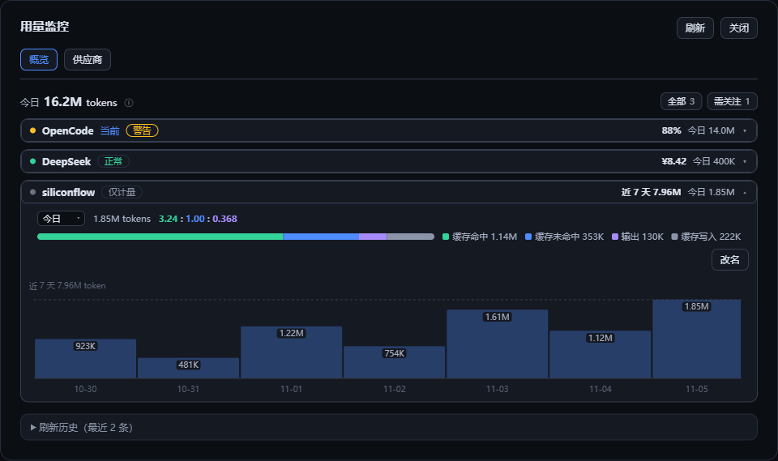
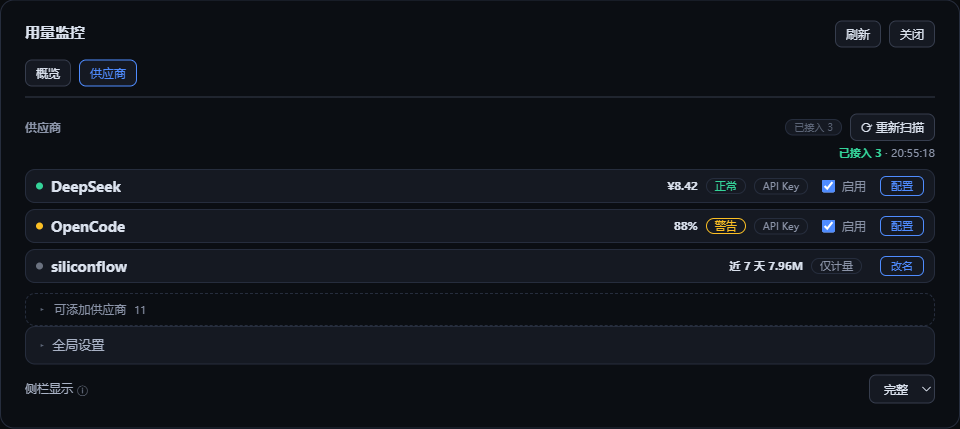

# dsh-token-quota

[](https://www.npmjs.com/package/@ds-hu/dsh-token-quota)
[](https://github.com/ds-hu/dsh-usage-monitor/actions/workflows/verify.yml)
[](#许可证)
[](#安装)

DeepSeek Harness 用量监控插件：查看当前会话对应供应商的周期限额、账户余额、报告费用与今日 Token 用量，
也能统计任何未内置供应商的 Token 消耗。支持 Windows 桌面端与 Web 界面。

中文 · [English](README.en.md)



当前版本：**v2.6.0**。要求 **DSH ≥ 0.1.7-rc.2**；真实桌面及 Web 验收环境为 **DSH 0.2.0-rc.2**。

Plugins 面板中显示为 **用量监控**（英文 **Usage monitor**）：图标是根目录 `icon.svg`，标题与一句话说明来自 `locale/zh.json` 与 `locale/en.json` 的 `meta`。

[npm](https://www.npmjs.com/package/@ds-hu/dsh-token-quota) · [问题反馈](https://github.com/ds-hu/dsh-usage-monitor/issues)

## v2.6.0 更新

- **任意供应商的 Token 统计**：DSH 里未归属到内置供应商的 LLM 路由，跑过一次就在概览里多出一条
  **「仅计量」**行——只有今日与近 N 天的 Token、五分量分布与归一比例，不查额度、不画百分比、
  不发任何新的外部请求。此前这类路由的用量被整段丢弃。
- **今日总量改为「概览列表里每一行之和」**：一行只要有今日用量就一定在列表里、也一定计入，
  可以逐行相加核对；「当前」标从此只表示小组件在用哪一家，不再等于「计入」。
- **DeepSeek 桌面登录与 API Key 合并成一行**：登录态产生的 Token 也计入今日用量，
  只有额度查询仍需要 API Key。
- 路由后来被插件支持时，`local:<route>` 的历史用量并入正式供应商，不从 0 开始；收编过程中
  在途步骤的替换样本不再被重复计入。
- 「近 N 天」的 N 取自用量保留期，不再一律写「近 7 天」。

## v2.5.0 更新

- 展开行的「Today」换成选择器：可切「今天 / 近 7 天」，token 数、归一比例与五分量分布条一起换成该区间的合计；图表固定 7 天，不跟着变。
- 同一行右侧给出各窗口的 token 估算（5h / 周 / 月），可在「剩余」与「套餐总量」之间切换；悬停显示取样区间、分子分母与 ±1pp 区间。
- 估算按取样内的斜率折算（本地 token ÷ Δpp），不再除以累计已用%：月窗口比本地留存长时，旧算法只拿得到最近几天的 token，会把总量算成一半。
- 修复图表柱值数字被折线压花：数字底下垫一层卡片底色，折线从数字背后穿过。

更早的逐版本记录见 [CHANGELOG](CHANGELOG.md)。

## 安装

插件从 npm 安装：**`@ds-hu/dsh-token-quota`**。离线部署时可以在源码目录 `npm pack` 打出 `ds-hu-dsh-token-quota-2.6.0.tgz`，用压缩包安装。插件包不包含 DeepSeek Harness；首次安装可能需要联网下载依赖。

### Windows 桌面端

先启动一次 DeepSeek Harness Desktop，完成初始化后完全退出。使用安装目录自带的 CLI，将插件添加到 **`desktop` profile**。请按实际位置修改路径。

```powershell
$desktopCli = 'D:\AI\DeepSeek- Harness\resources\runtime\cli\bin\dsh.cmd'
& $desktopCli plugin --profile desktop add @ds-hu/dsh-token-quota
& $desktopCli plugin --profile desktop list --depth 0
```

离线安装时把包名换成压缩包路径：

```powershell
$archivePath = (Resolve-Path './ds-hu-dsh-token-quota-2.6.0.tgz').Path
& $desktopCli plugin --profile desktop add "file:$archivePath"
```

重新打开桌面应用，展开左侧栏即可看到用量组件；也可从「设置 → 用量监控」进入。安装到 `web` profile 的插件不会自动出现在桌面端。桌面侧栏收起后组件随侧栏隐藏，展开后恢复。

### Web / CLI

先安装 DeepSeek Harness，确认 `dsh --version` 能正常运行。以下示例使用 `web` profile；使用其他 profile 时请替换名称。

从 npm 安装：

```bash
dsh plugin --profile web add @ds-hu/dsh-token-quota
dsh --profile web
```

离线安装（先 `npm pack` 得到压缩包）：

Linux / macOS：

```bash
dsh plugin --profile web add "file:$(pwd)/ds-hu-dsh-token-quota-2.6.0.tgz"
dsh --profile web
```

Windows PowerShell：

```powershell
$archivePath = (Resolve-Path './ds-hu-dsh-token-quota-2.6.0.tgz').Path
dsh plugin --profile web add "file:$archivePath"
dsh --profile web
```

若旧版本已提示重复路由，先完全退出 DSH，再安装 v2.0.4 并重新启动，以清除当前进程中遗留的旧路由。

安装或升级前，请先结束当前任务并退出对应 DSH 实例。压缩包升级时，用新包重新执行 `add` 命令，然后重启 DSH 并刷新 Web 页面。

### 从源码安装

```bash
git clone https://github.com/ds-hu/dsh-usage-monitor.git
cd dsh-usage-monitor
npm ci
dsh plugin --profile web add "link:$(pwd)"
dsh --profile web
```

PowerShell 中将链接安装命令替换为：

```powershell
$pluginDirectory = (Get-Location).Path
dsh plugin --profile web add "link:$pluginDirectory"
```

链接安装直接使用源码目录，请保留该目录及其依赖。更新时执行 `git pull --ff-only` 和 `npm ci`，再重启 DSH。

## 开始使用

1. 单击侧栏卡片打开「用量监控」面板；默认进入「概览」，宽窄布局一致。
2. 在「概览」展开某个供应商，查看全部指标、今日分布、峰谷与用量图；展开区的「配置」直达该供应商。
3. 或切到「供应商」页签点「重新扫描」，识别 Harness 已配置的普通 API Key；需要更高权限凭据的供应商请手动配置。
4. 打开供应商配置，填写必要字段、启用供应商并保存。秘密字段留空会保留旧值。
5. 使用「测试连接」检查已保存配置；需要调整查询频率、保留期或节假日覆盖表时，在「供应商」页底部展开「全局设置」并保存。

**密钥的两种写法。** 每个秘密字段都能填**密钥本体**（`apiKey`，`role('secret')` 脱敏保存），
或只填**凭据引用**（`apiKeyEnv`，DSH 凭据库里的记录名或环境变量名，例如 `COMMAND_CODE_API_KEY`）。
引用在宿主内存里按「DSH 凭据库 → 进程环境变量」解析，密钥本体不写进插件配置；`/state` 只回传引用名与
是否解析成功。重新扫描只写引用（`apiKeyEnv`），不再把密钥本体拷进 profile 配置；两者同时存在时本体优先，
且**任一已填即视为手动接管**（扫描不再改动该供应商的密钥字段）。「测试连接」对编辑器里刚填、还没保存的引用
也会先解析一次，不必先保存再测。

**DeepSeek 桌面登录的 Token 会计入，额度查询仍需要 API Key。** 登录态产生的调用以 `deepseek-account` 路由上报，插件把它并进同一行 DeepSeek，因此今日与近 N 天的 Token 不配 Key 也能看到；余额只能按 API Key 查——只想看额度时，请在现有 DeepSeek 供应商配置中填写同一账户的 API Key，或配置 Harness 的 DeepSeek API Key 路由后重新扫描。

## 侧栏与面板

完整侧栏分三段：**plan 名**（供应商显示名，不显示模型名）、**关注限额进度条**（可多条并排，每条自带真名短标签、已用百分比与该窗口的重置倒计时）、以及常显的**计费时段档位**（峰价／谷价与下次切换）。阈值颜色直接落在进度条上：绿 < 警告 < 黄 < 临界 < 红；多条时每条按自己的百分比分档，并共享列宽严格对齐。没有配置关注限额时退回**周窗口**，没有周窗口才改用已用比例最高的有效窗口，只有余额或报告费用时保留文字而不画条；旧数据与已停用保持中性色。今日 Token 用量不再占侧栏一行，改在概览的供应商行里按供应商展示（无障碍标签仍可读到）。没有可查询指标的「仅计量」行第 2 行不画条，改显这个窗口自己的量。Token 数量一律 3 位有效数字（如 `1.32M`、`12.0K`）。紧凑侧栏保留供应商名与主指标文字。独立箭头切换显示状态，偏好保存在当前浏览器；宽度不足时自动使用紧凑显示，恢复宽度后恢复用户选择。

**关注限额**在「供应商 → 配置」页勾选：勾选顺序即卡片排列顺序，行内 ↑↓ 调整，未勾选 = 用默认规则。候选项来自上一次成功查询里带身份的可画条目（`5h 滚动`／`周用量`／`月用量`／`allowance` 等）；已勾选但这次查询没返回的项标注「当前不可用」并暂不画条，数据回来自动恢复。配置只影响侧栏卡片第 2 行，不改变概览、紧凑行与供应商明细里的主指标口径。

单击侧栏卡片打开「用量监控」面板。面板只有「概览」「供应商」两个页签；卡片进入默认概览，宿主「设置 → 用量监控」进入默认供应商。对话框形态下按 Esc、点遮罩或「关闭」收起，焦点回到侧栏卡片。

概览按已添加供应商列出名称、状态、主指标与今日量（「仅计量」行也在其中，状态写作「仅计量」），一次只展开一行；列表上方的今日总量就是这些行今日量之和，可以逐行相加核对。展开后给出按额度、余额、报告分组的指标表格，今日五分量分布（只用一条五分量条）与**归一比例**（「缓存命中 : 缓存未命中 : 输出」，未命中固定为 1，例如 `30.0 : 1.00 : 0.150`，三段各保留 3 位有效数字），DeepSeek 的计费时段拆分，以及一张**把柱状图与折线图合成的时间图**：柱是每日 Token 消耗，每根有量的柱标出当日用量（窗口过长时只标峰值），图顶给出窗口合计；折线是各窗口的剩余额度，共用同一条时间轴；折线在额度回落处断开（说明换了新窗口），图例给出各窗口当前剩余百分比。首次展开时按需取一次额度历史，同一次面板会话内复用。默认收起的刷新历史表格最多展示最近 50 条。

「供应商」页签列出已添加目录、启用开关、配置入口与重新扫描；底部折叠「全局设置」（查询间隔、用量保留期、节假日覆盖表；缺次年时在摘要外点名告警）与侧栏显示偏好。可添加供应商默认收起。



| 页签 | 内容 |
| --- | --- |
| 概览 | 今日总量、全部/需关注筛选、可展开的供应商明细、默认收起的刷新历史。 |
| 供应商 | 已添加目录、启用开关、配置入口、重新扫描、全局设置、侧栏显示、可添加目录。 |

查询间隔默认 **60 秒**，范围 **10–3600 秒**；用量保留期默认 **7 天**，范围 **1–90 天**。后台刷新及页签切换保留编辑草稿；插件内部返回、取消或关闭时，会提示放弃未保存修改。宿主直接离开原生设置分区会销毁面板，无法保留未保存草稿。

## 数据含义

- **今日用量**：概览列表里每一行（已添加供应商，含仅计量行）通过 Harness 产生的当日 Token 用量之和，按宿主本地日统计。一行只要有今日用量就必然在列表里，所以这个合计可以逐行相加核对。独立 CLI 或其他应用中的调用不计入。
- **用量分布**：今日用量按 DSH 的互不相交口径拆成五项（未缓存输入、输出、缓存命中、缓存写入、未细分），五项之和恒等于今日总量。比例只取前三项并归一到「缓存未命中 = 1」。
- **剩余额度**：按 `100 − 已用百分比` 派生。额度在一个窗口内只增不减，因此百分比回落即表示换了新窗口，折线在此断开。只对带百分比的窗口（`5h`／`周`／`月` 等）成立；余额与报告费用没有百分比，不进折线。
- **周期限额**：百分比表示已用比例；常驻卡片第 2 行画的是用户配置的**关注限额**（可多条、按配置顺序），没配置时固定取周窗口、没有周窗口再取已用比例最高的有效窗口；每条的重置时间始终对应它自己的窗口。概览与紧凑侧栏的主指标仍取已用比例最高的有效窗口。
- **计费时段**：DeepSeek 账号级的峰谷计价（按北京时间判定）是账户事实，因此常显在卡片最后一行；当日用量是否分属峰谷只在概览展开的供应商明细里按供应商给出。缺次年节假日安排时会在「供应商」页底部全局设置旁点名。
- **余额**：逐币种显示，不换算、不相加。
- **报告费用与报告用量**：保留供应商报告的周期，与本地今日 Token 统计分别展示。
- **未知与零值**：缺失或未知显示 `—`，真实零值显示 `0`；当前会话尚无调用时显示「暂无调用」。
- **更新失败**：有旧数据时显示「更新失败 · 上次数据」及可用的成功数据时间；没有旧数据时显示「暂时无法获取」。

切换会话不会借用其他会话的供应商。失败刷新保留同一配置下的旧结果；修改查询配置后清除该供应商的旧结果。

## 支持的供应商

| 供应商 | 查询内容 | 凭据 | 配置方式 |
| --- | --- | --- | --- |
| DeepSeek | 账户余额，保留多币种 | 普通 API Key | 自动识别或手动 |
| OpenRouter | 当前 Key 周期额度及今日费用 | 普通 API Key | 自动识别或手动 |
| OpenRouter 账户 | 账户 credits | Management Key | 手动 |
| OpenAI 组织 | 最近完整 UTC 日的用量与费用 | 组织 Admin Key | 手动 |
| Anthropic 组织 | 组织用量与费用 | 组织 Admin Key | 手动 |
| Moonshot 国内／国际 | 账户余额 | 普通 API Key | 自动识别或手动 |
| Z.ai／智谱 Coding Plan | 套餐窗口限额 | 普通 API Key | 自动识别或手动 |
| MiniMax 国内／国际 | Token Plan 窗口限额 | 普通 API Key | 自动识别或手动 |
| OpenCode（兼容来源） | 5 小时、周、月窗口及 allowance | 普通 API Key／OAuth | 自动识别或手动 |
| Command Code（兼容来源） | 5 小时、周窗口及套餐月额度 | 普通 API Key | 自动识别或手动 |

普通 API Key、Management Key 与 Admin Key 分别配置。插件不会将普通聊天密钥用于组织管理接口，也不会覆盖手动填写的密钥或重新启用显式关闭的供应商。

### 任意供应商（仅计量）

上表没有的供应商也有 token 统计：DSH 里未归属到上表的 LLM 路由，产生过一次真实调用后就会在概览里出现一条
**「仅计量」**行——只有今日与近 N 天的 Token、五分量分布与归一比例，不查额度、不画百分比、不发新的外部请求。
此前这类路由的用量被整段丢弃，「今日总量」因此比真实调用少一块。

- 行由流量产生：不能手工添加，也不能停用（没有可关掉的采集器）；在「供应商」页可改名，默认名取路由 id 或 DSH 的显示名。
  行跟着本地用量一起进退：保留期（默认 7 天）内没有新用量、旧桶被清理后，这一行也随之消失。
- 卡片的第 1 行仍是名字与今日数，第 2 行没有进度条，给的是这个窗口（近 N 天，N 取保留期）的量。
- 这些行恒进「今日总量」，但不属于「需关注」，也不进关注限额与阈值分档；明细里没有指标表，也没有「数据时间」——它从不查询。
- 路由后来被本插件支持时，`local:<route>` 的历史用量并入正式供应商，不从 0 开始，并入前后今日总量不变。
- DeepSeek 桌面登录（`deepseek-account`）与 API Key 是同一条账户的两条路，合并成同一行 DeepSeek，不会出现两行重复记账；
  只有登录态、没有可查额度的 Key 时，这一行照样出现在概览里并计入今日总量（只是状态显示「未查询」）。

官方查询仅接受对应的 HTTPS 主机与已知基础路径；不符合要求的地址不会发送请求。OpenCode 与 Command Code 使用兼容接口，其可用性取决于供应商接口。表格表示插件支持的查询能力，不代表所有真实账户均已完成验证。

## 数据保存与升级

配置保存在对应 profile 的插件行配置中；秘密字段使用宿主的秘密字段机制。界面中秘密字段留空表示保留，清除时需编辑 `$DSH_HOME/profiles/<profile>/cordis.patch.yml` 中 `id: dsh-token-quota` 对应的配置。

本地 Token 用量按「供应商 × 小时 × 分量」保存至 `$DSH_HOME/dsh-token-quota/usage.json`，按保留期修剪。文件为 `version: 2`，小时桶记录互不相交的五项：未缓存输入、输出、缓存命中、缓存写入与未细分（四项分量之和即总量）。版本 1 文件里的总数在读取时归入「未细分」，不猜分布、不丢总量，下一次保存写成版本 2；旧版插件读到版本 2 会判为不支持并保留原文件。刷新历史仅保存在内存中，重启后清空。

额度历史保存在同目录的 `quota.json`（`version: 1`）：按「供应商 × 指标」记录**已用百分比的变化点**（`[时刻, 已用百分比]`），不变的值不重复记录。磁盘保留 **14 天**、每指标最多 600 个点，超出丢弃最旧的；与用量文件共用一次防抖落盘与同一把短写锁，跨进程按时刻并集合并（重复合并不会翻倍）。额度历史是按需传输的：只有概览首次展开供应商时请求 `/state?quota=1` 才裁剪到当前展示窗口并降采样到 ≤120 点，同一面板会话内复用，常驻卡片轮询不携带它。文件损坏或版本不符时按「无历史」处理并保留原文件，不影响卡片与今日用量。

从旧版升级时，插件会在当前行尚无用户配置的条件下读取旧 `settings.yaml` 或 `settings.yaml.imported` 中的 `dsh-token-quota`／`quota-monitor` 配置，迁移后保留来源文件。旧用量目录 `quota-monitor` 仅在新目录不存在时迁移。

**v1.1.1 及更早版本用户**：旧插件名为 `dsh-usage-monitor` 或 `dsh-quota-monitor`。先用 `dsh plugin --profile <profile> list --depth 0` 确认，再移除旧包并安装新包，避免同时运行。

## 限制

- 仅观测经过 Harness 的调用；本机 Codex CLI 登录状态和独立 CLI 用量不在范围内。
- 「仅计量」行只有 Token：没有额度、余额与百分比可看，也不能手工添加或停用。
- 供应商未返回重置时间时，不推算或补造时间；无限额度和未知余额保留未知。
- 趋势图只覆盖本地记录：额度折线依赖插件运行期间采样，装插件之前的历史无从补录；额度历史磁盘保留 14 天，展示窗口跟随用量保留期（默认 7 天），期间没有查询就没有点。
- 本地用量统计与供应商账单可能因周期、时区和统计范围不同而不同。
- 真实供应商余额、付费调用及 Admin／Management Key 账户需要使用实际凭据另行验证。
- 当前 HTTP 接口面向本机同源访问；反向代理的公开来源配置需另行处理。
- 用量文件损坏或版本不支持时保留原文件并提示错误；退出时无法写入的增量不能保证保存。

## 开发与验证

```bash
npm ci --ignore-scripts
npm test
npx playwright install chromium
npm run test:browser
npm run test:pack
npm pack
```

真实宿主验收使用独立数据目录与 profile，不修改日常配置：

```powershell
npm run test:desktop -- --app 'C:/path/DeepSeek Harness.exe' --package 'C:/path/ds-hu-dsh-token-quota-2.6.0.tgz' --output '.scratch/desktop-v2-check'
node scripts/verify-web.mjs --app 'C:/path/DeepSeek Harness.exe' --package 'C:/path/ds-hu-dsh-token-quota-2.6.0.tgz' --output '.scratch/web-v2-check'
npm run test:lifecycle -- --app 'C:/path/DeepSeek Harness.exe' --output '.scratch/lifecycle-v2-check'
```

输出目录需为未使用过的目录。供应商解析测试使用模拟响应；真实 Desktop 与 Web 验收检查安装、界面、配置持久化和重新扫描，不发送聊天消息或配置真实供应商密钥。

[桌面兼容性说明](docs/windows-desktop-adaptation.md) · [单一面板重构记录](docs/single-panel-refactor-execution.md) · [ADR-0002](docs/adr/0002-single-monitor-surface.md) · [侧栏与设置实施记录](docs/sidebar-settings-iteration-plan.md) · [v2.5.0 发布记录](docs/v2.5.0-release-execution.md)

## 来源与致谢

本仓库是 [shxtmaker/dsh-token-quota](https://github.com/shxtmaker/dsh-token-quota) 的 fork，在 npm 上以
`@ds-hu/dsh-token-quota` 发布。插件 id、设置命名空间、数据目录与各家供应商的查询规则都沿用上游，
行为变更逐条记在 [CHANGELOG](CHANGELOG.md)。上游没有 npm 包，需要它的原始版本请用上游的 Releases。

## 许可证

MIT。
